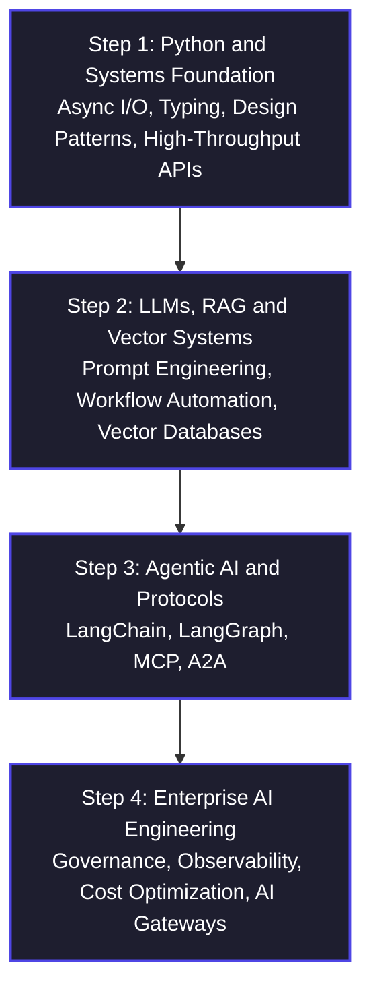

# Agentic AI & Forward Deployed Engineering (FDE)

<p align="center">
  
  
  
  
  
</p>

---

## Executive Overview

Welcome to the central repository for **Agentic AI & Forward Deployed Engineering (FDE)**.

This repository serves as a comprehensive learning resource, code repository, and hands-on laboratory for engineers building production-ready AI systems. It covers the fundamentals of Python and LLMs, retrieval-augmented generation (RAG), autonomous agents, multi-agent architectures, and enterprise AI engineering.

The goal is to bridge the gap between theoretical knowledge and practical implementation by providing structured learning materials, working code examples, hands-on assignments, and architectural guidance.

> **The FDE Advantage:** Forward Deployed Engineering combines software engineering, AI capabilities, and direct collaboration with business teams to solve real-world problems. FDEs build and deploy solutions in real operational environments, using agentic workflows, tool integrations, and observability to accelerate delivery while maintaining reliability, security, and governance.

---

---

## Master Curriculum Roadmap

The curriculum progresses from software engineering fundamentals to the development, deployment, and governance of production-grade AI agents.




## Technology Stack and Architecture

The architecture combines application interfaces, backend services, data infrastructure, and AI orchestration to support scalable and maintainable agentic applications.

```text
[ Users / Edge Devices ]
          |
          v
[ API / Ingestion Gateway ]
          |
          v
[ Backend Services ]
          |
          +----------------------+
          |                      |
          v                      v
[ PostgreSQL / Vector DB ]  [ Redis / Cache ]
          |
          v
[ AI Agent Core - LangGraph ]
          |
          v
[ LLMs / MCP Tools / External APIs ]
          |
          v
[ Application UI / Next.js Dashboard ]

Cross-cutting capabilities:
Observability | Security | Governance | Cost Management
```

### Core Technology Components

* **Frontend and Visualization:** Next.js, React, Tailwind CSS.
* **Backend and Ingestion:** Python, Go, FastAPI, and IoT integration services.
* **Data and Vector Storage:** PostgreSQL with pgvector, Redis, Chroma, and Qdrant.
* **AI and Agent Orchestration:** LangChain, LangGraph, and Model Context Protocol (MCP).
* **Agent Communication:** Agent-to-Agent (A2A) protocol and interoperable service integrations.
* **AI Gateways and Observability:** LiteLLM Proxy, LangSmith, and Langfuse.
* **Security and Governance:** Guardrails AI, access controls, audit logging, and usage policies.

---

## Learning Objectives

By completing this learning path, engineers should be able to:

1. Build robust backend services and asynchronous applications using Python.
2. Integrate LLMs into applications using structured prompts, APIs, and RAG pipelines.
3. Develop stateful AI agents with tool-calling and workflow orchestration.
4. Connect agents to external systems using MCP and interoperable communication protocols.
5. Design multi-agent workflows with controlled execution and error handling.
6. Implement observability, evaluation, security controls, and cost-management practices.
7. Deploy and operate AI-powered applications with enterprise reliability and maintainability in mind.

---


<p align="center">
  <i>Building reliable, secure, and production-ready AI systems through practical engineering.</i>
</p>
